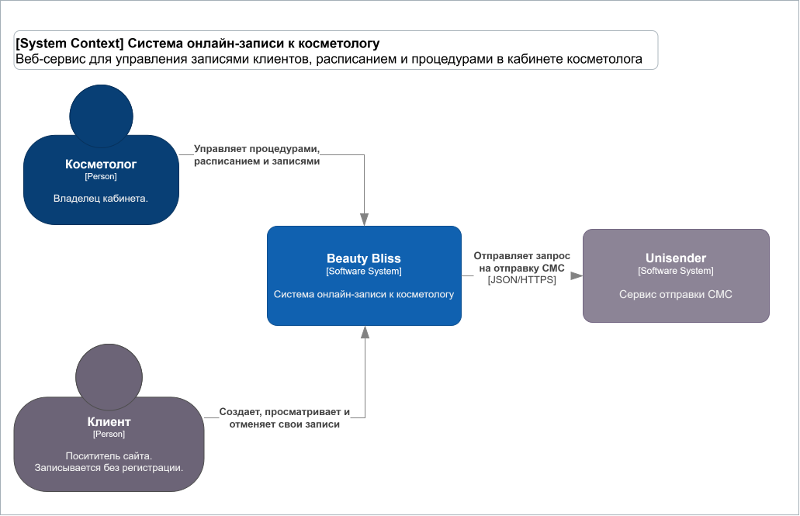
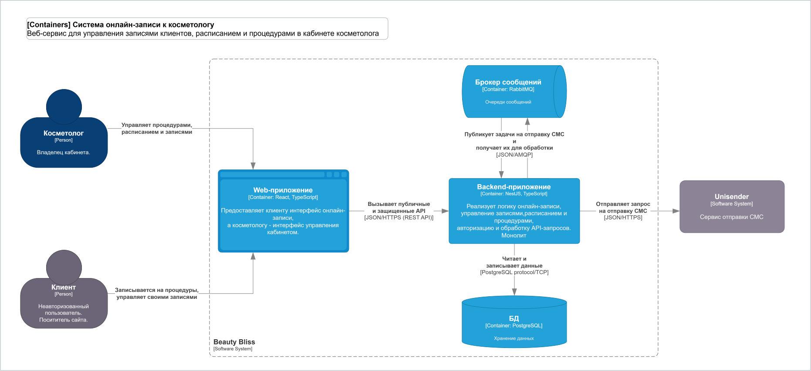

# Архитектура системы Beauty Bliss

В данном разделе представлена архитектура системы онлайн-записи Beauty Bliss, описанная с использованием **модели C4**.

В портфолио представлены диаграммы двух уровней: C1-context и C2-container.

## C1 - System Context Diagram

Диаграмма контекста определяет границы Beauty Bliss, показывает пользователей, внешние системы и взаимодействия между ними.

[Исходный файл диаграммы в формате .drawio](context-diagram.drawio)

## C2 - Container Diagram

Диаграмма контейнеров показывает техническую структуру Beauty Bliss: основные приложения, сервисы и хранилища данных, а также взаимодействия между ними.

[Исходный файл диаграммы в формате .drawio](container-diagram.drawio)