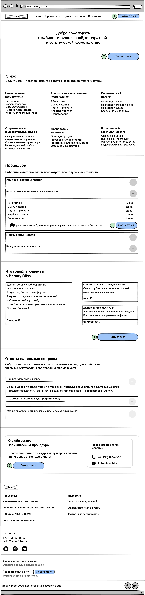
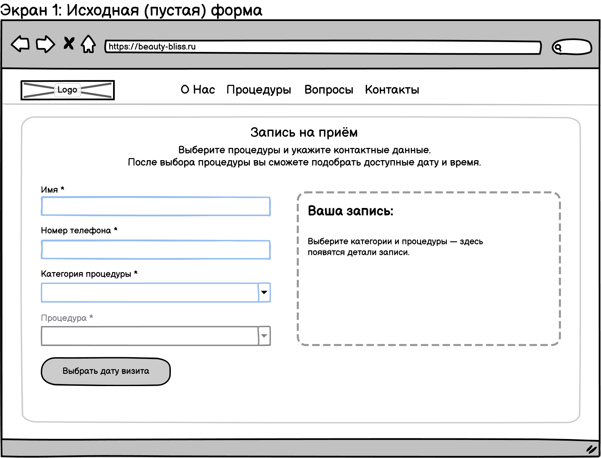
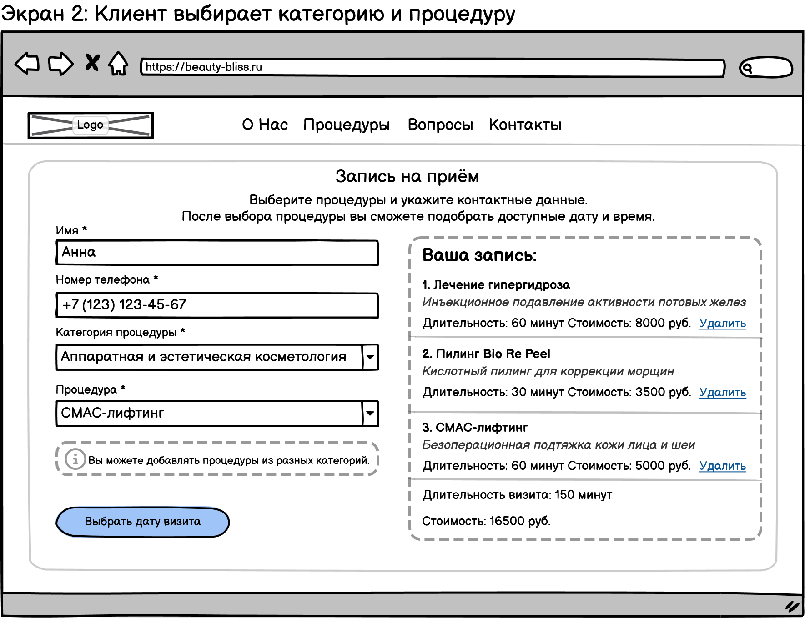
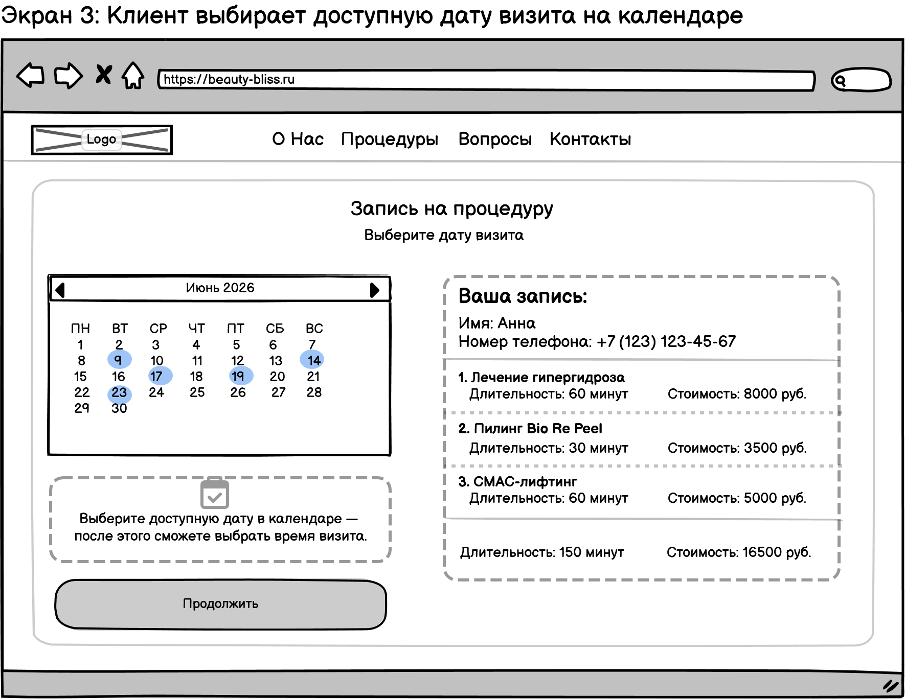
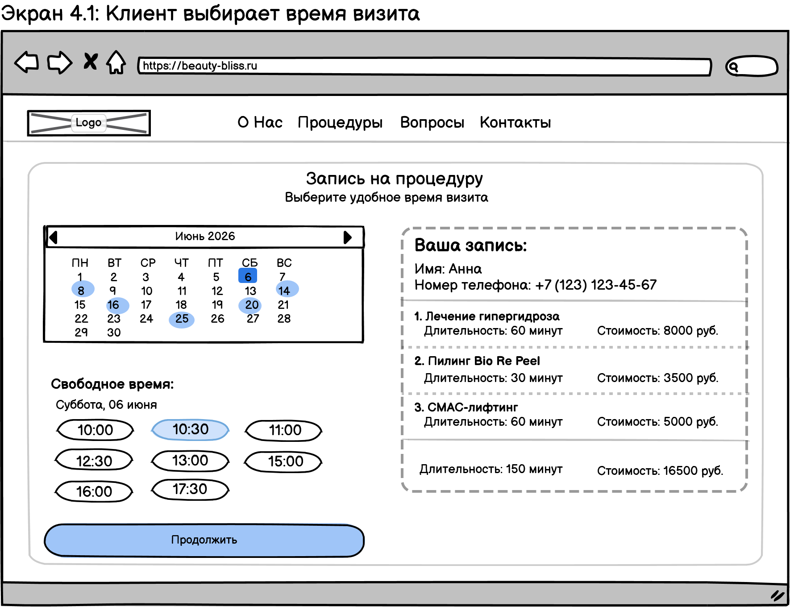
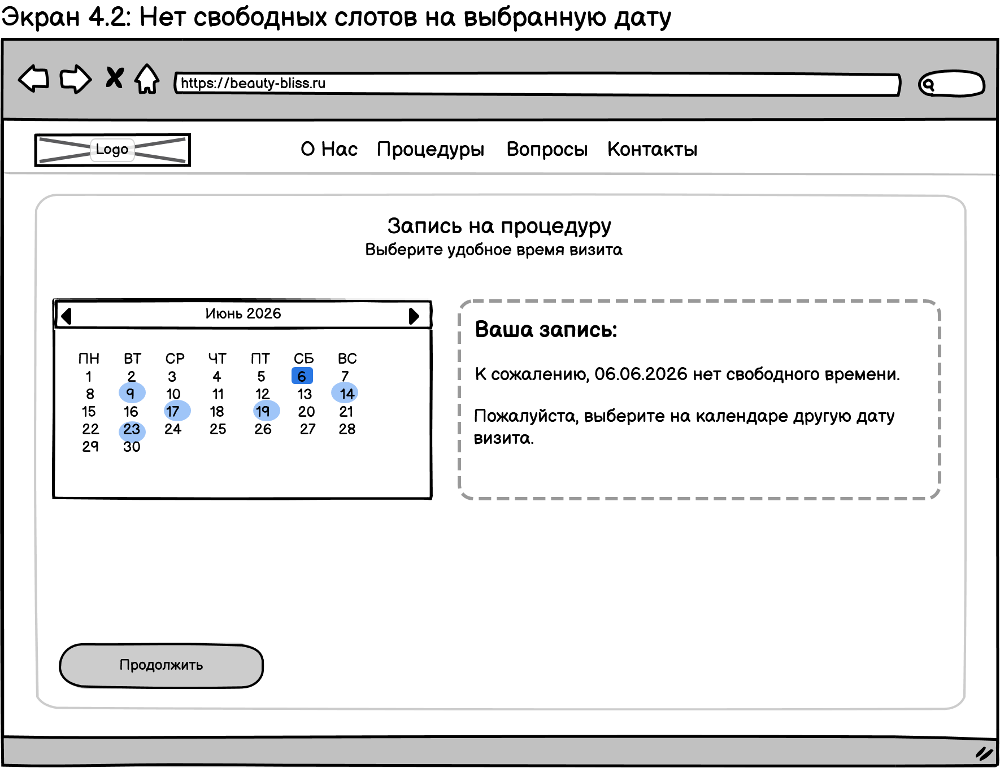
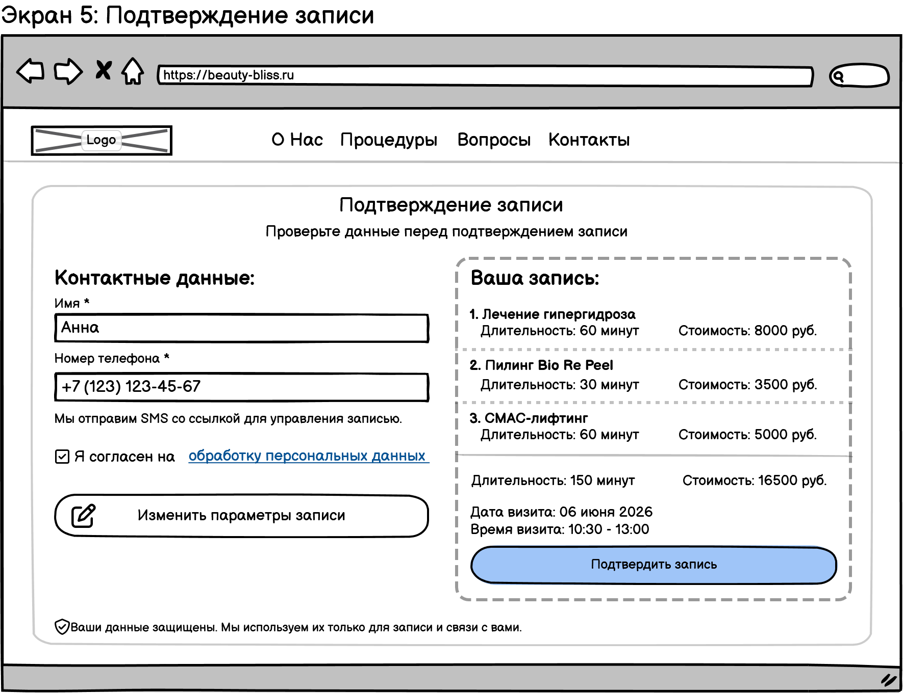
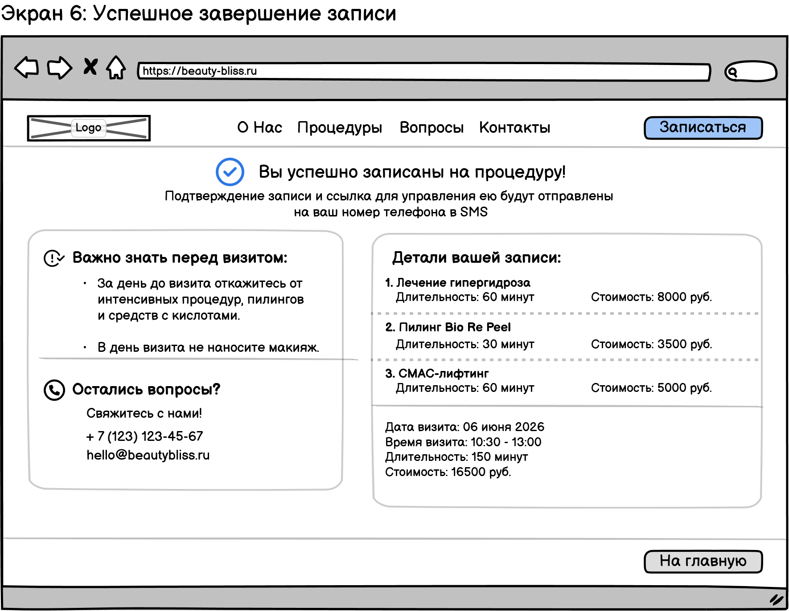

Варфреймы

В разделе представлены варфреймы пользовательского интерфейса Beauty Bliss.

Варфреймы демонстрируют главную страницу сайта, точки входа в онлайн-запись и сценарий клиента от выбора процедур до успешного создания записи.

## 1. Лендинг

Главная страница сайта содержит информацию о процедурах косметолога, их стоимости, отзывах и ответах на часто задаваемые вопросы.

На лендинге предусмотрено пять точек входа в сценарий онлайн-записи через кнопки «Записаться».

## 2. Сценарий онлайн-записи

Клиент может записаться на одну или несколько процедур из разных категорий в рамках одного визита.

### Шаг 1. Начало записи

Клиент переходит к форме онлайн-записи, вводит контактные данные и приступает к выбору категорий процедур.

### Шаг 2. Выбор процедур

Клиент выбирает одну или несколько процедур из выбранной(ых) категорий. Система формирует список выбранных процедур и рассчитывает общую продолжительность и стоимость визита.

### Шаг 3. Выбор даты

Клиент выбирает желаемую дату визита в календаре.

### Шаг 4. Выбор времени

Система отображает свободные временные слоты с учетом общей продолжительности выбранных процедур. Клиент выбирает подходящее время.

Если на выбранную дату свободных слотов нет, система предлагает выбрать другую дату.

### Шаг 5. Подтверждение записи

Клиент проверяет параметры визита, подтверждает согласие на обработку персональных данных и создает запись.

### Шаг 6. Успешная запись

Система отображает подтверждение записи и информацию о предстоящем визите. Клиенту будет отправлено SMS со ссылкой для управления записью.

